# CHIRP

> High-Performance 4D FMCW Automotive Radar Perception & Synthetic Aperture Radar (SAR) Engine in MATLAB and C MEX

[](https://github.com/aneesh495/chirp/actions/workflows/ci.yml)
[](https://www.mathworks.com/products/matlab.html)
[](https://www.octave.org)
[-brightgreen.svg)](#verification-campaign)
[](LICENSE)
[](#compliance)

---

## Table of Contents

- [Overview](#overview)
- [System Architecture](#system-architecture)
- [Key Engineering Capabilities](#key-engineering-capabilities)
  - [1. FMCW Waveform Synthesis & Ambiguity Analysis](#1-fmcw-waveform-synthesis--ambiguity-analysis)
  - [2. Multi-Channel MIMO Virtual Array & Channel Physics](#2-multi-channel-mimo-virtual-array--channel-physics)
  - [3. 2D Range-Doppler Spectral Processing & MTI](#3-2d-range-doppler-spectral-processing--mti)
  - [4. Direction of Arrival (AoA) Super-Resolution](#4-direction-of-arrival-aoa-super-resolution)
  - [5. 2D Adaptive CFAR Detectors & Integral Image Prefix Sums](#5-2d-adaptive-cfar-detectors--integral-image-prefix-sums)
  - [6. 4D Point Cloud Perception & Doppler-Aware DBSCAN](#6-4d-point-cloud-perception--doppler-aware-dbscan)
  - [7. Multi-Target Tracking (IMM-UKF, GNN, JPDA)](#7-multi-target-tracking-imm-ukf-gnn-jpda)
  - [8. Synthetic Aperture Radar (SAR) Imaging Engines](#8-synthetic-aperture-radar-sar-imaging-engines)
  - [9. Micro-Doppler Gait Classification](#9-micro-doppler-gait-classification)
  - [10. Hardware Telemetry Ingest & I/O Codecs](#10-hardware-telemetry-ingest--io-codecs)
  - [11. Native C MEX Acceleration Kernels](#11-native-c-mex-acceleration-kernels)
  - [12. Terminal ANSI Scopes & Vector SVG Visualizers](#12-terminal-ansi-scopes--vector-svg-visualizers)
- [Performance Benchmarks](#performance-benchmarks)
- [Verification Campaign & Zero-Defect Audit](#verification-campaign--zero-defect-audit)
- [Architectural Decision Records (ADR)](#architectural-decision-records-adr)
- [Quickstart Guide](#quickstart-guide)
  - [Prerequisites](#prerequisites)
  - [Compilation](#compilation)
  - [Command-Line Interface](#command-line-interface)
  - [Running Test Suites](#running-test-suites)
  - [Running Examples](#running-examples)

---

## Overview

**CHIRP** is an end-to-end radar signal processing and synthetic aperture imaging engine engineered from first principles in MATLAB and C. It bridges raw millimeter-wave analog-to-digital converter (ADC) time-series data to full 4D track-level situational awareness and sub-meter SAR imagery.

The toolbox implements physical electromagnetic wave propagation, MIMO spatial convolution, 2D Range-Doppler Fourier transforms, constant false alarm rate (CFAR) detection, super-resolution angle estimation, Doppler-penalized spatial clustering, and Interacting Multiple Model (IMM) Kalman filtering.

```
+---------------------------------------------------------------------------------------------------+
|                                      CHIRP RADAR PERCEPTION ENGINE                                |
+------------------+------------------+------------------+--------------------+---------------------+
|    Waveforms     |    Simulation    |     Core DSP     |  Detection & AoA   |  Perception & SAR   |
| FMCW / Stepped   | MIMO Co-Arrays   | 2D Range-Doppler | 2D CFAR (CA/GO/SO) | 4D Point Clouds     |
| Ambiguity Func   | Swerling I-IV    | Blackman/Cheby   | 2D OS-CFAR         | Velocity DBSCAN     |
| Barker / Frank   | Multipath 2-Ray  | MTI Filtering    | MUSIC / Root-MUSIC | IMM-UKF Tracking    |
| Zadoff-Chu       | Atmospheric ITU  | Chinese Remainder| ESPRIT / Monopulse | Backprojection SAR  |
+------------------+------------------+------------------+--------------------+---------------------+
```

---

## System Architecture

```mermaid
flowchart LR
    subgraph Ingest["1. Signal Ingestion & RF Synthesis"]
        ADC["Raw Baseband ADC / DCA1000"] --> Dechirp["De-Chirping & Mixing"]
        MIMO_Sim["MIMO Channel Simulation"] --> Dechirp
    end

    subgraph Spectral["2. Range-Doppler Spectral DSP"]
        Dechirp --> Cube["4D Radar Cube [Nr x Nv x Nc]"]
        Cube --> RFFT["Range-FFT + Windowing"]
        RFFT --> DFFT["Doppler-FFT + MTI"]
        DFFT --> RDM["Range-Doppler Map (NCI)"]
    end

    subgraph Detection["3. CFAR & AoA Estimation"]
        RDM --> CFAR["2D CFAR (CA/GO/SO/OS)"]
        CFAR --> AoA["Spatial Covariance R = E[xx^H]"]
        AoA --> SuperRes["MUSIC / Root-MUSIC / ESPRIT"]
    end

    subgraph Perception["4. Point Cloud & Tracking"]
        SuperRes --> PCL["4D Point Cloud (X, Y, Z, V, SNR)"]
        PCL --> DBSCAN["Doppler-Aware DBSCAN"]
        DBSCAN --> Tracker["IMM-UKF Multi-Target Tracker"]
    end

    subgraph Auxiliary["5. SAR Imaging & Micro-Doppler"]
        Cube --> SAR["Time-Domain Backprojection (BPA)"]
        DFFT --> STFT["STFT / Synchrosqueezing"]
        STFT --> Classifier["Kinematic Target Classifier"]
    end

    Tracker --> Output["Visualizers (ANSI / SVG) & I/O (PLY / LAS / RCUBE)"]
    SAR --> Output
    Classifier --> Output
```



---

## Key Engineering Capabilities

### 1. FMCW Waveform Synthesis & Ambiguity Analysis
- **Continuous-Wave Chirps**: Generates frequency ramps $f(t) = f_0 + S t$ with user-defined start frequencies, sweep bandwidths, idle times, and ADC sampling rates.
- **Ambiguity Function**: Computes 2D radar ambiguity surfaces $|\chi(\tau, \nu)|^2$ over delay and Doppler to analyze range-Doppler coupling and sidelobe energy.
- **Phase-Coded Modulations**: Barker codes (lengths 2 to 13), Frank polyphase codes, and Zadoff-Chu constant amplitude zero autocorrelation (CAZAC) sequences.
- **Stepped-Frequency Continuous-Wave (SFCW)**: Reconstructs synthetic wideband high-resolution range profiles from stepped carrier pulses via IDFT.

### 2. Multi-Channel MIMO Virtual Array & Channel Physics
- **Virtual Array Convolution**: Computes the spatial co-array convolution of physical TX and RX antenna element coordinates ($N_{\text{virt}} = N_{\text{TX}} \times N_{\text{RX}}$), modeling automotive 77 GHz layouts (e.g. 3-TX by 4-RX yielding a 12-element non-redundant uniform linear array).
- **Target Fluctuation**: Swerling models 0, I, II, III, and IV for pulse-to-pulse and scan-to-scan radar cross-section (RCS) statistics.
- **Electromagnetic Propagation**: Two-ray ground reflection multipath channels with grazing angle calculation and ITU-R P.676 atmospheric oxygen/water vapor attenuation.

### 3. 2D Range-Doppler Spectral Processing & MTI
- **Fast-Time Processing**: Windowed discrete Fourier transforms with sidelobe suppression (Hann, Hamming, Blackman-Harris, Chebyshev, Kaiser).
- **Slow-Time Processing**: Doppler FFT resolving radial velocities across chirps with phase correction.
- **Doppler Ambiguity Resolution**: Resolves velocities beyond $V_{\text{max}}$ using Chinese Remainder Theorem on staggered dual-PRF pulse streams.
- **Ground Clutter Filtering**: Single and double delay Moving Target Indication (MTI) cancelers and polynomial trend rejection.

### 4. Direction of Arrival (AoA) Super-Resolution
- **Fourier Beamforming**: Classical Bartlett phase-shift beamformer with spatial spectrum scanning.
- **Adaptive MVDR**: Capon Minimum Variance Distortionless Response beamformer with diagonal loading covariance regularization.
- **Subspace Super-Resolution**: Multiple Signal Classification (MUSIC) with forward-backward spatial smoothing for correlated signals.
- **Search-Free Estimators**: Closed-form polynomial root-finding via Root-MUSIC and rotational invariance extraction via ESPRIT.
- **Monopulse Extraction**: Single-snapshot amplitude and phase comparison monopulse angle estimation.

### 5. 2D Adaptive CFAR Detectors & Integral Image Prefix Sums
- **Comprehensive Algorithm Suite**: Cell-Averaging (CA), Greatest-Of (GO), Smallest-Of (SO), Ordered-Statistic (OS), and Trimmed-Mean (TM).
- **Constant-Time Evaluation**: 2D integral image (summed-area table) prefix sums calculate sliding-window reference noise in $O(1)$ time per cell.
- **Sub-Cell Peak Interpolation**: Quadratic 2D paraboloid surface fitting for fractional range-Doppler peak localization.

### 6. 4D Point Cloud Perception & Doppler-Aware DBSCAN
- **Point Cloud Container**: 4D points $[x, y, z, v_r]$ with signal-to-noise ratio, RCS, and scan timestamps.
- **Spatial Indexing**: Balanced $k$-d tree (`SpatialKdTree`) supporting $O(\log N)$ radius searches and $k$-NN queries.
- **Doppler-Aware DBSCAN**: Couples spatial and velocity metrics into an ellipsoidal distance function:
  $$D(p_1, p_2) = \sqrt{\frac{\|\mathbf{r}_1 - \mathbf{r}_2\|^2}{\epsilon_{\text{range}}^2} + \frac{(v_1 - v_2)^2}{\epsilon_{\text{velocity}}^2}} \le 1.0$$
- **Oriented Bounding Boxes**: Minimum-volume 3D bounding boxes with orientation yaw angles fitted to clustered points via principal component analysis.

### 7. Multi-Target Tracking (IMM-UKF, GNN, JPDA)
- **Non-Linear Filtering**: Extended Kalman Filter (EKF) and Unscented Kalman Filter (UKF) with non-linear spherical radar observation functions.
- **Maneuver Adaptation**: Interacting Multiple Model (IMM) filter combining Constant Velocity, Constant Acceleration, and Coordinated Turn kinematic models.
- **Data Association**: Global Nearest Neighbor (GNN) via 2D Hungarian assignment with Chi-squared Mahalanobis gating; Joint Probabilistic Data Association (JPDA) for dense multi-target clutter.
- **Track Lifecycle**: Finite state machine managing Tentative, Confirmed, Coasted, and Deleted tracks using $M$-out-of-$N$ hit counters.

### 8. Synthetic Aperture Radar (SAR) Imaging Engines
- **Time-Domain Backprojection (BPA)**: Exact slant-range matched-filter backprojection for arbitrary non-linear flight paths (Stripmap, Spotlight, and Circular SAR).
- **Frequency-Domain Engines**: Range-Doppler Algorithm (RDA) with Range Cell Migration Correction (RCMC), and Polar Format Algorithm (PFA) for spotlight scenes.
- **Motion Compensation**: Phase Gradient Autofocus (PGA) for non-parametric phase error estimation and image de-blurring.

### 9. Micro-Doppler Gait Classification
- **Time-Frequency Transforms**: Short-Time Fourier Transform (STFT), Wigner-Ville Distribution, and Synchrosqueezing Transform.
- **Biomechanical Features**: Stride cadence, torso velocity envelopes, micro-Doppler bandwidth, and spectral Shannon entropy.
- **Kinematic Classification**: Target classification categorizing pedestrian, cyclist, passenger vehicle, and rotary-wing drone returns.

### 10. Hardware Telemetry Ingest & I/O Codecs
- **TI DCA1000EVM Ingest**: Ethernet UDP stream parser with packet sequence tracking, dropped packet recovery, and 16-bit I/Q demultiplexing.
- **Standard Exporters**: PLY vector point clouds, LAS aerial point clouds, GeoJSON geospatial tracks, and binary `.rcube` containers.

### 11. Native C MEX Acceleration Kernels
- `chirp_cfar_2d_mex`: Integral-image 2D CFAR detector executing in 0.04 ms ($25,000+$ FPS).
- `chirp_range_fft_mex`: In-place Radix-2 Cooley-Tukey FFT kernel with bit-reversal and precomputed twiddles.
- `chirp_backprojection_mex`: Time-domain SAR backprojection kernel focusing $> 10$ Million pixels per second.

### 12. Terminal ANSI Scopes & Vector SVG Visualizers
- **Terminal ASCII Scopes**: Renders Range-Doppler heatmaps, point clouds, and PPI radar scopes directly into standard terminal output.
- **Vector SVG Generation**: Clean standalone SVG vector diagrams of point clouds with oriented bounding boxes, range rings, and micro-Doppler time-frequency spectrograms.

---

## Performance Benchmarks

Measured on Apple Silicon (M-series, ARM64) running GNU Octave 11.3.0 and compiled C MEX kernels:

| Benchmark Task | Data Size | Native Interpreted | Compiled C MEX | Speedup |
| :--- | :--- | :--- | :--- | :--- |
| **2D CA-CFAR Detection** | $128 \times 32$ RDM | $80.38\text{ ms}$ ($12.4\text{ FPS}$) | **$0.04\text{ ms}$ ($25,653\text{ FPS}$)** | **2,000x** |
| **SAR Backprojection** | $32 \times 32$ grid ($P=32$) | $3.0\text{ ms}$ ($340\text{ kPx/s}$) | **$0.1\text{ ms}$ ($13.0\text{ MPx/s}$)** | **38.1x** |
| **SAR Backprojection** | $64 \times 64$ grid ($P=64$) | $8.3\text{ ms}$ ($490\text{ kPx/s}$) | **$0.5\text{ ms}$ ($9.0\text{ MPx/s}$)** | **18.3x** |
| **SAR Backprojection** | $128 \times 128$ grid ($P=64$)| $26.2\text{ ms}$ ($625\text{ kPx/s}$) | **$1.8\text{ ms}$ ($9.2\text{ MPx/s}$)** | **14.8x** |
| **Range-FFT Processing** | $1024 \times 256 \times 16$ cube | $10.61\text{ ms}$ ($395\text{ MS/s}$) | **$59.05\text{ ms}$ ($71\text{ MS/s}$)** | Parity |

---

## Verification Campaign & Zero-Defect Audit

The master test verification harness (`make test` or `tests/run_all_tests.m`) executes 15 automated test suites:

| Test Suite | Category | Tested Behaviors & Assertions | Status |
| :--- | :--- | :--- | :--- |
| `test_waveform` | Unit | Chirp slope, beat mixing, Barker PSL, Frank, Zadoff-Chu, SFCW IDFT | **PASS** |
| `test_radar_sim` | Unit | FMCW cube dimensions, Swerling fluctuation, 2-ray multipath, ITU loss | **PASS** |
| `test_dsp` | Unit | Range-FFT, Doppler-FFT, MTI canceler, CRT Doppler de-aliasing, strict peaks | **PASS** |
| `test_aoa` | Unit | Bartlett, Capon MVDR, MUSIC, Root-MUSIC, ESPRIT, Monopulse | **PASS** |
| `test_cfar` | Unit | CA, GO, SO, OS, TM CFAR false alarm probability and thresholding | **PASS** |
| `test_pointcloud` | Unit | PointCloud4D transforms, k-d tree radius/kNN, Doppler DBSCAN, BoundingBox | **PASS** |
| `test_tracking` | Unit | EKF update, UKF sigma points, IMM mixing, GNN Hungarian, JPDA, Lifecycle | **PASS** |
| `test_microdoppler` | Unit | STFT spectrogram, biomechanical features, cadence extraction, classifier | **PASS** |
| `test_sar` | Unit | SAR flight geometry, slant range, Time-Domain Backprojection focal peak | **PASS** |
| `test_io` | Unit | DCA1000 UDP ingest, `.rcube` binary codec, PLY, LAS, GeoJSON formats | **PASS** |
| `test_mex_parity` | Unit | Numerical parity of C MEX vs MATLAB engines ($\Delta < 10^{-13}$) | **PASS** |
| `test_end_to_end_perception` | Integration | Full electromagnetic waveform to 4D IMM multi-target tracking | **PASS** |
| `test_negative_controls` | Audit | Pure noise false alarm validation, invalid inputs, edge cases | **PASS** |
| `test_mathematical_invariants`| Audit | Parseval energy conservation, Hermitian covariance, Kalman monotonicity | **PASS** |
| `test_no_em_dashes` | Audit | Static compliance check asserting zero em dashes across entire repo | **PASS** |

---

## Architectural Decision Records (ADR)

Detailed design documents are maintained in `docs/adr/`:
- [ADR-0001: MIMO Virtual Array Geometry and Spatial Co-Array Synthesis](docs/adr/ADR-0001-mimo-virtual-array-geometry.md)
- [ADR-0002: 2D CFAR Detection and Adaptive Thresholding Strategy](docs/adr/ADR-0002-cfar-detection-thresholding.md)
- [ADR-0003: Time-Domain Backprojection versus Frequency-Domain SAR](docs/adr/ADR-0003-sar-backprojection-vs-frequency-domain.md)
- [ADR-0004: Doppler-Aware Ellipsoidal Metric for Point Cloud Clustering](docs/adr/ADR-0004-doppler-aware-clustering-metric.md)
- [ADR-0005: Native C MEX Acceleration and Pure MATLAB Fallback Strategy](docs/adr/ADR-0005-native-mex-c-fallback-strategy.md)

---

## Quickstart Guide

### Prerequisites
- **MATLAB** (R2021a or newer) OR **GNU Octave** (11.0 or newer).
- A C compiler (`gcc` or `clang`) for building MEX acceleration kernels (optional; pure MATLAB fallbacks run automatically).

### Compilation
Compile the native C MEX acceleration kernels:
```bash
make mex
```

### Command-Line Interface
CHIRP includes a POSIX executable command-line interface (`bin/chirp`):
```bash
# Print toolbox version and banner
./bin/chirp version

# Run the master automated test verification harness
./bin/chirp test

# Run the performance benchmark suite
./bin/chirp bench

# Run interactive perception and imaging demonstrations
./bin/chirp demo perception
./bin/chirp demo sar
./bin/chirp demo microdoppler
./bin/chirp demo mimo
```

### Running Test Suites
From within MATLAB or GNU Octave:
```matlab
addpath('tests');
run_all_tests();
```

### Running Examples
```matlab
addpath('examples');

% 1. End-to-end 4D automotive perception pipeline
demo_4d_automotive_radar();

% 2. Airborne SAR time-domain backprojection imaging
demo_sar_airborne_imaging();

% 3. Human walking gait micro-Doppler classification
demo_pedestrian_microdoppler();

% 4. MIMO virtual array synthesis and sub-Rayleigh super-resolution AoA
demo_mimo_virtual_array();
```

---

## License

MIT License. See [LICENSE](LICENSE) for details.
