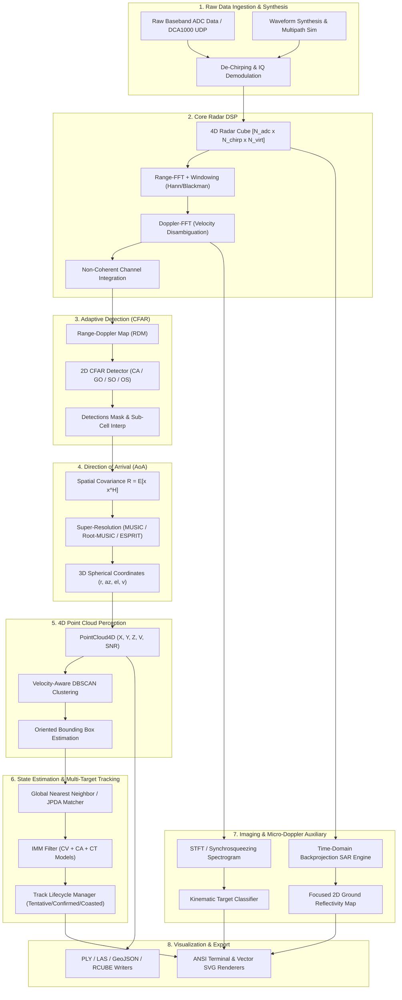

# System Architecture and Design Specification

## Overview

CHIRP is a modular, high-performance Radar Signal Processing and Synthetic Aperture Radar (SAR) perception engine written in MATLAB with native C MEX acceleration kernels. The architecture is engineered to provide an end-to-end processing pipeline transforming raw analog-to-digital converter (ADC) electromagnetic reflections into track-level 4D situational awareness and focused sub-meter radar imagery.

## System Data Flow Pipeline

The end-to-end data processing pipeline flows through eight sequential stages:

## Package Architecture

The codebase is organized into modular packages under the `+chirp` namespace:

| Package | Description | Core Classes |
| :--- | :--- | :--- |
| `+chirp/+utils` | Physical constants, fast bitwise math, matrix utilities, CRC32 | `PhysicalConstants`, `FastMath`, `MatrixUtils`, `Crc32`, `StatUtils` |
| `+chirp/+waveform` | Waveform definitions, ambiguity functions, phase modulation | `FmcwChirp`, `AmbiguityFunction`, `PhaseCodeModulator`, `WaveformGenerator` |
| `+chirp/+sim` | Multi-channel physical radar and RF channel simulation | `RadarConfig`, `TargetModel`, `SwerlingModel`, `MimoArray`, `RadarSimulator` |
| `+chirp/+dsp` | 2D Range-Doppler processing, MTI filtering, phase calibration | `RangeProcessor`, `DopplerProcessor`, `RangeDopplerMap`, `MtiFilter`, `DopplerAmbiguityResolver` |
| `+chirp/+aoa` | Direction of Arrival beamforming and super-resolution | `BartlettBeamformer`, `CaponBeamformer`, `MusicEstimator`, `RootMusicEstimator`, `EspritEstimator` |
| `+chirp/+cfar` | Adaptive thresholding detectors and sub-cell interpolation | `CaCfar`, `GoCfar`, `SoCfar`, `OsCfar`, `TmCfar`, `ThresholdCalculator` |
| `+chirp/+pointcloud`| 4D Point cloud representations, spatial indexing, clustering | `PointCloud4D`, `SpatialKdTree`, `VelocityAwareDbscan`, `BoundingBoxEstimator` |
| `+chirp/+tracking` | Multi-target state estimation, Kalman filters, data association| `ExtendedKalmanFilter`, `UnscentedKalmanFilter`, `ImmFilter`, `GnnTracker`, `JpdaTracker` |
| `+chirp/+microdoppler`| Time-frequency transforms, gait cadence, target classification | `StftAnalyzer`, `SynchrosqueezingTransform`, `MicroDopplerFeatures`, `KinematicClassifier` |
| `+chirp/+sar` | Synthetic aperture radar image reconstruction algorithms | `SarGeometry`, `BackprojectionEngine`, `RangeDopplerAlgorithm`, `PolarFormatAlgorithm` |
| `+chirp/+io` | Hardware capture readers, standard format exporters | `Dca1000Reader`, `RadarCubeCodec`, `PlyWriter`, `LasWriter`, `GeoJsonWriter` |
| `+chirp/+viz` | Terminal ANSI scopes, vector SVG visualizers | `TerminalHeatmap`, `TerminalPointCloud`, `SvgPointCloudRenderer`, `PolarPlotRenderer` |

## Memory Layout and Tensor Representations

Radar cubes are organized in column-major continuous memory buffers:
- **Fast-Time (ADC Samples)**: Dimension 1 ($N_{\text{adc}}$ samples along the frequency chirp sweep).
- **Slow-Time (Chirp Index)**: Dimension 2 ($N_{\text{chirps}}$ pulses per frame).
- **Spatial (Virtual Channel)**: Dimension 3 ($N_{\text{virt}} = N_{\text{TX}} \times N_{\text{RX}}$ virtual co-array phase centers).

This memory layout ensures that the first processing step (1D Range-FFT) operates on contiguous memory columns, maximizing CPU L1/L2 cache hit rates and enabling SIMD auto-vectorization.
