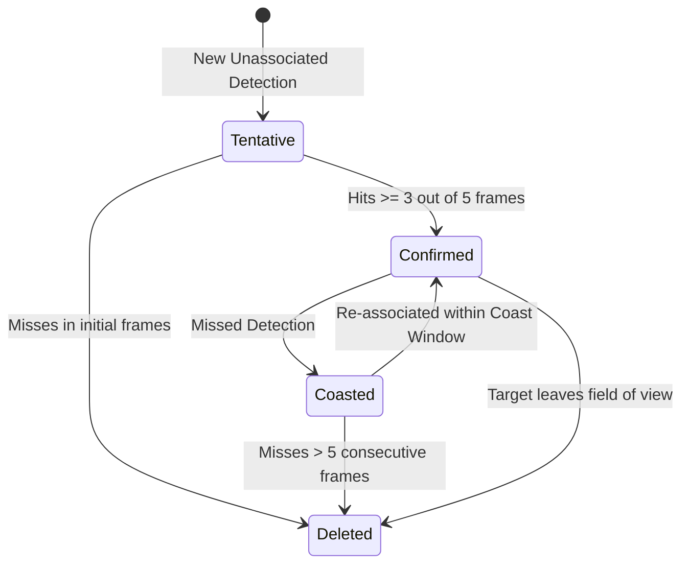

# Multi-Target State Estimation and Sensor Tracking

## 1. Kinematic Coordinate Transformations and Measurement Models

Radar detections are natively measured in spherical polar radar coordinates:

$$\mathbf{z} = [r, \theta, \phi, v_r]^T$$

where:
- $r$: Slant range (m)
- $\theta$: Azimuth angle in horizontal plane (rad)
- $\phi$: Elevation angle above horizontal plane (rad)
- $v_r$: Line-of-sight radial Doppler velocity (m/s)

Target state vectors are maintained in 3D Cartesian tracking frames:

$$\mathbf{x} = [p_x, p_y, p_z, v_x, v_y, v_z]^T$$

### Non-Linear Observation Function
The non-linear measurement mapping $\mathbf{z} = h(\mathbf{x})$ is:

$$r = \sqrt{p_x^2 + p_y^2 + p_z^2}$$

$$\theta = \text{atan2}(p_x, p_y)$$

$$\phi = \text{asin}\left( \frac{p_z}{r} \right)$$

$$v_r = \frac{p_x v_x + p_y v_y + p_z v_z}{r}$$

### Observation Jacobian Matrix
For the Extended Kalman Filter (EKF), the measurement Jacobian $\mathbf{H} = \left. \frac{\partial h}{\partial \mathbf{x}} \right|_{\hat{\mathbf{x}}}$ is:

$$\mathbf{H} = \begin{bmatrix}
\frac{p_x}{r} & \frac{p_y}{r} & \frac{p_z}{r} & 0 & 0 & 0 \\
\frac{p_y}{p_x^2 + p_y^2} & \frac{-p_x}{p_x^2 + p_y^2} & 0 & 0 & 0 & 0 \\
\frac{-p_x p_z}{r^2 \sqrt{p_x^2 + p_y^2}} & \frac{-p_y p_z}{r^2 \sqrt{p_x^2 + p_y^2}} & \frac{\sqrt{p_x^2 + p_y^2}}{r^2} & 0 & 0 & 0 \\
\frac{v_x}{r} - \frac{p_x v_r}{r^2} & \frac{v_y}{r} - \frac{p_y v_r}{r^2} & \frac{v_z}{r} - \frac{p_z v_r}{r^2} & \frac{p_x}{r} & \frac{p_y}{r} & \frac{p_z}{r}
\end{bmatrix}$$

## 2. Unscented Kalman Filter (UKF) Formulation

To avoid linearization divergence and Jacobian singularities at close ranges, CHIRP implements the Unscented Kalman Filter using the Scaled Unscented Transform.

### Sigma Point Generation
For an $n$-dimensional state vector $\hat{\mathbf{x}}$ with covariance $\mathbf{P}$, $2n + 1$ deterministic sigma points are generated:

$$\boldsymbol{\chi}_0 = \hat{\mathbf{x}}$$

$$\boldsymbol{\chi}_i = \hat{\mathbf{x}} + \left( \sqrt{(n + \lambda) \mathbf{P}} \right)_i, \quad i = 1, \dots, n$$

$$\boldsymbol{\chi}_{i+n} = \hat{\mathbf{x}} - \left( \sqrt{(n + \lambda) \mathbf{P}} \right)_i, \quad i = 1, \dots, n$$

where the composite scaling parameter is $\lambda = \alpha^2 (n + \kappa) - n$.
- $\alpha = 10^{-3}$: Controls sigma point spread (tight clustering near the mean).
- $\kappa = 0$: Secondary scaling parameter.
- $\beta = 2.0$: Optimal parameter incorporating higher-order prior Gaussian knowledge.

Sigma point weights for mean and covariance are:

$$W_0^{(m)} = \frac{\lambda}{n + \lambda}, \quad W_0^{(c)} = \frac{\lambda}{n + \lambda} + (1 - \alpha^2 + \beta)$$

$$W_i^{(m)} = W_i^{(c)} = \frac{1}{2(n + \lambda)}, \quad i = 1, \dots, 2n$$

The sigma points are propagated through non-linear observation function $\boldsymbol{\mathcal{Z}}_i = h(\boldsymbol{\chi}_i)$, capturing true posterior mean and covariance up to 3rd-order Taylor terms.

## 3. Interacting Multiple Model (IMM) Filter

Vehicles and pedestrians exhibit multiple distinct physical maneuver modes throughout their trajectories. A single motion model either lags during sharp turns or produces high variance during steady straight cruising.

The IMM filter runs three parallel Kalman filters under different kinematic hypothesis models:
1. **Constant Velocity (CV)**: Linear straight-line motion with low process noise ($q = 0.5\text{ m/s}^2$).
2. **Constant Acceleration (CA)**: Longitudinal acceleration/braking with state $[p_x, p_y, p_z, v_x, v_y, v_z, a_x, a_y, a_z]^T$.
3. **Coordinated Turn (CT)**: Constant turn rate $\omega$ with state $[p_x, p_y, v_x, v_y, \omega]^T$.

### Model Interaction and Mixing
At each time step:
1. **Interaction**: Mode probabilities $\mu_j$ weight state and covariance mixing according to a Markov transition probability matrix $\mathbf{\Pi}$:

$$\mu_{i|j} = \frac{\pi_{ij} \mu_i}{\sum_k \pi_{kj} \mu_k}$$

2. **Filtering**: Each filter updates its state independently using incoming radar measurements.
3. **Model Probability Update**: Likelihoods $\Lambda_j = \mathcal{N}(\mathbf{y}_j; \mathbf{0}, \mathbf{S}_j)$ update model weights:

$$\mu_j = \frac{\Lambda_j \sum_i \pi_{ij} \mu_i}{\sum_k \Lambda_k \sum_i \pi_{ik} \mu_i}$$

4. **Combination**: The output state is a Gaussian mixture weighted by posterior mode probabilities $\mu_j$.

## 4. Data Association: GNN and JPDA

### Mahalanobis Distance Gating
Before association, candidate measurements $\mathbf{z}_m$ are validated against predicted track measurements $\hat{\mathbf{z}}_t$ using normalized innovation squared (Mahalanobis distance):

$$d_M^2 = (\mathbf{z}_m - \hat{\mathbf{z}}_t)^T \mathbf{S}_t^{-1} (\mathbf{z}_m - \hat{\mathbf{z}}_t) \le \gamma_{\text{gate}}$$

where threshold $\gamma_{\text{gate}}$ is set from the Chi-squared inverse distribution ($\chi^2_4(\alpha = 0.999) \approx 18.47$).

### Global Nearest Neighbor (GNN)
A global cost matrix $C_{ij} = d_M^2(t_i, m_j)$ is constructed. The 2D Hungarian (Munkres) assignment algorithm finds the globally optimal one-to-one assignment minimizing total association distance in $O(N^3)$ time.

### Joint Probabilistic Data Association (JPDA)
In dense multi-target scenarios where clutter creates overlapping gates, JPDA calculates marginal association probabilities $\beta_{tj}$ across all feasible joint event hypotheses, weighting innovations without hard combinatorial assignment decisions.

## 5. Track Lifecycle State Machine

Tracks transition through four operational states:

- **Tentative**: Initialized on unassociated measurements; suppressed from user outputs.
- **Confirmed**: Promoted when $M$-out-of-$N$ (e.g. 3 of 5) consecutive scans associate valid detections.
- **Coasted**: Propagated purely via motion prediction without measurement correction when occluded.
- **Deleted**: Purged from memory after maximum coast lifetime (e.g. 5 consecutive frames).
